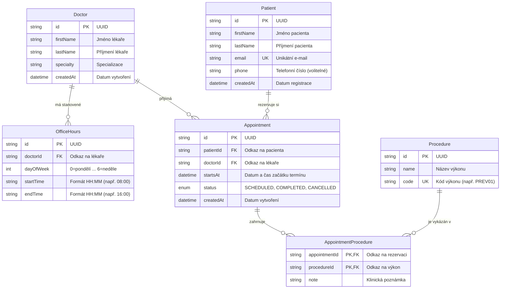

# Technická dokumentace — Rezervace v ordinaci

Semestrální projekt předmětu Pokročilé programování (KPPRO), ZS 2026/2027  
Fakulta informatiky a managementu, Univerzita Hradec Králové

---

## 1. Titulní strana

- **Název aplikace:** Rezervace v ordinaci (Medical Appointment Booking System)
- **Zvolené zadání:** Zadání A — Rezervace v ordinaci
- **Autor / Student:** [DOPLŇTE JMÉNO A PŘÍJMENÍ]
- **Studijní obor:** [DOPLŇTE OBOR, např. Aplikovaná informatika / Informační management]
- **Akademický rok:** 2026/2027 (Zimní semestr)
- **Vyučující / Konzultant:** Dominik Palla (`dominik.palla@uhk.cz`)
- **Datum:** Listopad 2026

---

## 2. Úvod

Aplikace **Rezervace v ordinaci** představuje backendový systém pro správu a plánování návštěv pacientů u lékařů různých specializací. Systém řeší typické provozní výzvy ambulancí a poliklinik:

1. **Efektivní plánování a prevence kolizí:** Eliminuje vznik dvojitých rezervací u stejného lékaře na tentýž časový slot pomocí databázového unikátního indexu i aplikační validace.
2. **Respektování ordinačních hodin:** Zabraňuje rezervacím mimo pracovní dobu lékaře (včetně podpory pro dělené ordinační hodiny s polední pauzou).
3. **Výpočet volných termínů:** Poskytuje lékařům i pacientům přehled o reálně dostupných časových slotech pro libovolný pracovní den po odečtení aktivních rezervací.
4. **Evidence provedených výkonů (M:N):** Umožňuje k jednotlivým uskutečněným návštěvám přiřazovat provedené lékařské výkony (např. odběr krve, EKG, preventivní prohlídka) včetně doplňujících klinických poznámek.
5. **Životní cyklus rezervace:** Podporuje vytvoření, zrušení (uvolnění slotu) i přesun rezervace na jiný dostupný termín.

Aplikace je navržena pro spolehlivý provoz v kontejnerizovaném prostředí Docker a klade důraz na striktní oddělení zodpovědností do tří architektonických vrstev.

---

## 3. Datový model

Datový model je realizován v relační databázi PostgreSQL a definován v Prisma schématu (`app/prisma/schema.prisma`). Model obsahuje **5 hlavních entit** a **1 vazební entitu M:N**.

### 3.1 Entitně-vztahový diagram (ERD)



### 3.2 Popis entit a atributů

1. **`Doctor` (Lékař):**
   - Reprezentuje zdravotnického pracovníka.
   - Atributy: `id` (UUID, primární klíč), `firstName`, `lastName`, `specialty` (obor/specializace), `createdAt`.
   - Vazby: 1:N k `OfficeHours` (lékař má více bloků ordinačních hodin), 1:N k `Appointment`.

2. **`OfficeHours` (Ordinační hodiny):**
   - Určuje časový rámec, kdy lékař ordinuje.
   - Atributy: `id` (UUID), `doctorId` (cizí klíč), `dayOfWeek` (celé číslo 0–6, kde 0 odpovídá pondělí a 6 neděli), `startTime` ("HH:MM"), `endTime` ("HH:MM").
   - Index na `doctorId` pro rychlé vyhledání provozní doby lékaře.

3. **`Patient` (Pacient):**
   - Reprezentuje registrovaného pacienta ordinace.
   - Atributy: `id` (UUID), `firstName`, `lastName`, `email` (unikátní klíč bránící duplicitním účtům), `phone`, `createdAt`.
   - Vazby: 1:N k `Appointment`.

4. **`Appointment` (Rezervace termínu):**
   - Reprezentuje konkrétní návštěvu pacienta u zvoleného lékaře.
   - Atributy: `id` (UUID), `patientId` (cizí klíč), `doctorId` (cizí klíč), `startsAt` (přesný čas začátku), `status` (výčtový typ: `SCHEDULED`, `COMPLETED`, `CANCELLED`), `createdAt`.
   - **Kritický unikátní index:** `@@unique([doctorId, startsAt])` — databázová úroveň striktně znemožňuje vznik dvou rezervací pro stejného lékaře na shodný čas.
   - Index na `patientId` pro rychlý přehled historie návštěv pacienta.

5. **`Procedure` (Lékařský výkon):**
   - Katalog dostupných zákroků a vyšetření.
   - Atributy: `id` (UUID), `name`, `code` (unikátní kód výkonu, např. `PREV01`, `BLD01`).

6. **`AppointmentProcedure` (Vazební entita M:N):**
   - Realizuje vazbu mnoho-k-mnoha mezi `Appointment` a `Procedure`.
   - Jedna návštěva může zahrnovat více provedených výkonů; jeden kód výkonu se opakuje napříč mnoha návštěvami.
   - Složený primární klíč: `@@id([appointmentId, procedureId])`.
   - Doplňkový atribut: `note` (nepovinná textová poznámka o průběhu výkonu).

### 3.3 Doporučený nástroj pro vizualizaci ERD do PDF
- Pro export do finálního PDF doporučujeme online editor **Mermaid Live Editor** (`mermaid.live`), **draw.io** nebo automatický generátor schémat **Prisma ERD Generator** (`@mermaid-js/mermaid-cli`).

---

## 4. Architektura systému

Projekt striktně implementuje **třívrstvou architekturu** s jednosměrným tokem závislostí:

```
[ Prezentační vrstva (src/api) ]
              │
              ▼
[ Aplikační / Business vrstva (src/application) ]
              │
              ▼
[ Databázová / Infrastrukturní vrstva (src/infrastructure) ]
              │
              ▼
    [ PostgreSQL Databáze ]
```

### 4.1 Pravidla a zajištění jednosměrnosti

1. **Prezentační vrstva (`src/api`):**
   - Implementována pomocí Express.js routerů (`appointments.ts`, `doctors.ts`, `patients.ts`, `procedures.ts`).
   - Má na starosti **výhradně** příjem HTTP požadavků, parsování a validaci vstupů (prostřednictvím schémat knihovny `zod`), volání metod aplikační vrstvy a překlad doménových výjimek na příslušné HTTP status kódy (400, 404, 409).
   - **Pravidlo povinného minima:** V této vrstvě se **nevyskytuje žádný SQL dotaz ani přímé volání Prisma klienta**.

2. **Aplikační / Business vrstva (`src/application`):**
   - Obsahuje jádro doménové logiky (`appointmentService.ts`, `doctorService.ts`, `patientService.ts`, `procedureService.ts`, `dateUtils.ts`).
   - Řídí transakce, ověřuje ordinační hodiny, počítá volné časové sloty (`calculateFreeSlots`), kontroluje návaznosti a vyhazuje typované doménové chyby (`DoubleBookingError`, `OutsideOfficeHoursError`, `AppointmentNotFoundError`, `DuplicateEmailError`, apod.).
   - Nemá žádnou závislost na HTTP, Expressu ani formátu síťových požadavků.

3. **Infrastrukturní / Databázová vrstva (`src/infrastructure`):**
   - Zapouzdřuje konfiguraci a jedinou instanci Prisma klienta (`src/infrastructure/db/prisma.ts`).
   - Přístup k databázi probíhá přes typované Prisma dotazy a verzované SQL migrace.

---

## 5. Použité technologie

| Technologie | Účel v projektu | Důvod volby |
|---|---|---|
| **TypeScript (5.6)** | Programovací jazyk | Poskytuje statickou typovou kontrolu, eliminuje běhové chyby a umožňuje sdílení rozhraní napříč vrstvami. |
| **Node.js (22 LTS)** | Běhové prostředí | Rychlé, moderní prostředí s nativní podporou ECMAScript modulů a širokým ekosystémem. |
| **Express.js (4.21)** | Webový aplikační framework | Minimalistický, ověřený a přímočarý HTTP směrovač pro tvorbu RESTful API bez zbytečného balastu. |
| **Prisma ORM (5.20)** | Databázová vrstva / ORM | Typově bezpečný přístup k databázi, deklarativní modelování a plná podpora verzovaných SQL migrací. |
| **PostgreSQL (16.4)** | Relační databáze | Robustní, ACID-kompatibilní databázový stroj s podporou složených unikátních indexů a integrity cizích klíčů. |
| **Docker & Docker Compose** | Kontejnerizace a orchestrace | Garantuje identické běhové prostředí pro aplikaci i databázi jedním příkazem bez nutnosti lokální instalace PostgreSQL. |
| **Vitest (2.1)** | Testovací framework | Rychlý běh jednotkových i integračních testů s nativní podporou TypeScriptu. |
| **Zod (3.23)** | Validace vstupních dat | Deklarativní validace schémat příchozích HTTP dotazů s automatickým odvozením TypeScript typů. |

---

## 6. Spuštění a instalace

### 6.1 Prerekvizity
- Nainstalovaný **Docker Engine** a **Docker Compose** (nebo Docker Desktop pro Windows/macOS).
- Volné porty `3000` (aplikace) a `5432` (databáze).

### 6.2 Postup spuštění krok za krokem

1. **Naklonování repozitáře a přechod do složky:**
   ```bash
   cd "C:\Users\Creator\Desktop\UHK-co udělat\06 - Pokrocile programovani (KPPRO)\Projekt - semestralni projekt"
   ```

2. **Příprava konfiguračního souboru:**
   Zkopírujte vzorový soubor s proměnnými prostředí:
   ```bash
   # Linux / macOS / PowerShell
   cp .env.example .env
   ```
   *Obsah `.env` obsahuje výchozí přístupové údaje:*
   ```env
   POSTGRES_USER=ordinace
   POSTGRES_PASSWORD=change-me
   POSTGRES_DB=ordinace
   POSTGRES_PORT=5432
   APP_PORT=3000
   ```

3. **Spuštění kontejnerů:**
   ```bash
   docker compose up -d
   ```
   Příkaz provede:
   - Stažení a start PostgreSQL 16.4 s healthcheckem.
   - Sestavení produkčního Docker obrazu aplikace (Node.js 22-slim, instalace openssl, překlad TypeScriptu).
   - Automatické spuštění databázových migrací (`npx prisma migrate deploy`).
   - Start Express serveru na portu `3000`.

4. **Ověření stavu aplikace (Health check):**
   ```bash
   curl http://localhost:3000/health
   # Očekávaná odpověď: {"status":"ok"}
   ```

### 6.3 Přehled API koncových bodů (REST API)

| Metoda | Endpoint | Popis |
|---|---|---|
| `GET` | `/health` | Kontrola stavu běžící aplikace |
| `GET` | `/doctors` | Seznam lékařů (volitelně `?specialty=kardio`) |
| `GET` | `/doctors/:id` | Detail lékaře včetně ordinačních hodin |
| `POST` | `/doctors` | Vytvoření lékaře a jeho ordinačních hodin |
| `PUT` | `/doctors/:id` | Úprava údajů lékaře a ordinačních hodin |
| `GET` | `/patients` | Seznam pacientů (volitelně `?search=novak`) |
| `GET` | `/patients/:id` | Detail pacienta včetně historie návštěv |
| `POST` | `/patients` | Registrace nového pacienta (unikátní e-mail) |
| `PUT` | `/patients/:id` | Úprava údajů pacienta |
| `GET` | `/procedures` | Seznam lékařských výkonů |
| `GET` | `/procedures/:id` | Detail lékařského výkonu |
| `POST` | `/procedures` | Založení nového výkonu (unikátní kód) |
| `GET` | `/appointments` | Seznam rezervací (filtry `?doctorId=`, `?patientId=`, `?status=`) |
| `GET` | `/appointments/:id` | Detail rezervace včetně výkonů |
| `POST` | `/appointments` | Vytvoření rezervace (validace termínu a ordinačních hodin) |
| `DELETE` | `/appointments/:id` | Zrušení rezervace (stav `CANCELLED`, uvolnění slotu) |
| `POST` | `/appointments/:id/cancel` | Alternativní zrušení rezervace |
| `POST` | `/appointments/:id/reschedule` | Přesun rezervace na nový termín |
| `POST` | `/appointments/:id/procedures` | Přiřazení provedeného výkonu k návštěvě (M:N) |
| `GET` | `/appointments/doctor/:doctorId/day/:date` | **Výpočet volných slotů pro zadaný den** |

---

## 7. Testy

Projekt obsahuje rozsáhlou sadu testů rozdělených na čisté jednotkové testy doménové logiky a integrační testy ověřující interakci s databází PostgreSQL.

### 7.1 Struktura testů

1. **Jednotkové testy (`tests/dateUtils.test.ts`, `tests/slotCalculation.test.ts`, `tests/validation.test.ts`):**
   - Testují čisté funkce bez závislosti na běžící databázi.
   - Ověřují generování volných slotů (`calculateFreeSlots`), odečítání obsazených termínů, chování při polední pauze, dny bez ordinačních hodin a hraniční časové intervaly.
   - Ověřují validace vstupních řetězců, převody formátů `HH:MM` na minuty a převod indexů dnů v týdnu (pondělí = 0).

2. **Integrační testy (`tests/appointmentService.test.ts`, `tests/patientDoctorProcedure.test.ts`):**
   - Testují kompletní doménové služby proti reálné databázi PostgreSQL.
   - Ověřují zachycení dvojité rezervace (`DoubleBookingError`), odmítnutí rezervace mimo ordinační hodiny (`OutsideOfficeHoursError`), uvolnění termínu po stornu, zákaz opakovaného storna a zápis M:N vazeb mezi návštěvami a výkony.

### 7.2 Spuštění testů

```bash
cd app

# Spuštění rychlých jednotkových testů (nevyžaduje Docker):
npm run test:unit

# Spuštění kompletní sady testů (vyžaduje běžící PostgreSQL na DATABASE_URL):
npm test
```

---

## 8. Protokol o zacyklení

Při živém testování v Dockeru (po dokončení endpointů pro zrušení a přesun rezervace) jsem narazil na to, že po zrušení rezervace nešlo stejný termín znovu obsadit — nový pokus skončil chybou "Na tento termín už má lékař jinou rezervaci", přestože předchozí rezervace měla stav `CANCELLED`. Prvním signálem byl pád integračního testu "zruší existující rezervaci a uvolní termín" na čistě nahozené databázi po `docker compose down -v && up -d`.

Příčina: unikátní index `(doctorId, startsAt)` v Prisma schématu platil pro úplně všechny rezervace bez ohledu na stav, takže zrušenou rezervaci databáze stále blokovala jako "obsazenou". Opravil jsem to novou migrací s parciálním unikátním indexem (`WHERE status <> 'CANCELLED'`), který se vztahuje jen na aktivní rezervace. Ověřil jsem to znovu spuštěním celé testovací sady (36/36 prošlo) i ručním otestováním přes API (vytvoření, zrušení a opětovné obsazení stejného termínu).

---

## 9. Přiznání práce s AI

- **Použité nástroje:** Claude (přes T3 Code) jako hlavní agent, který projekt řídil a prováděl živé testování v Dockeru; část implementace (CRUD endpointy, testy, první verze dokumentace) vygeneroval delegovaný subagent Google Antigravity (model Gemini 3.8 Flash).
- **Rozsah asistence:** Návrh datového modelu, třívrstvá architektura, CRUD vrstva, výpočet volných termínů, testy (jednotkové i integrační), Docker konfigurace, generování této PDF dokumentace a oprava chyby popsané v bodě 8 — tohle všechno vzniklo primárně prací AI agentů, ne mým ručním psaním kódu.
- **Moje role:** Zvolil jsem zadání A a technologický stack (TypeScript/Express/Prisma), trval jsem na tom, aby bylo řešení jednoduché a dobře obhajitelné, nechal jsem projekt skutečně spustit a otestovat v Dockeru (ne jen přečíst kód), a rozhodoval jsem o konkrétních zjednodušeních a dalším postupu.
- **Způsob ověření:** Aplikace byla spuštěná v Dockeru od nuly (`docker compose up -d`), testovací sada (36 testů) proběhla úspěšně a klíčové scénáře (rezervace, dvojí rezervace, zrušení a opětovné obsazení termínu) jsem si prošel ručně přes API.
